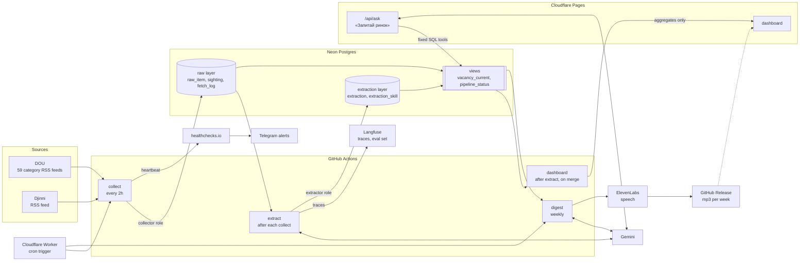

<div align="center">

<a href="https://it-pulse-ua.pages.dev/"></a>

# IT Pulse UA

**AI-аналітика українського IT-ринку вакансій: що наймають, скільки платять і куди рухається ринок.**

[](https://github.com/anastasiia-bilska/it-pulse-ua/actions/workflows/ci.yml)
[](https://github.com/anastasiia-bilska/it-pulse-ua/actions/workflows/collect.yml)
[](https://github.com/anastasiia-bilska/it-pulse-ua/actions/workflows/extract.yml)
[](https://github.com/anastasiia-bilska/it-pulse-ua/releases/latest)
<br />


### [🌐 Live dashboard](https://it-pulse-ua.pages.dev/) · [🇺🇦 Українською](https://it-pulse-ua.pages.dev/uk) · [🎧 Weekly digest](https://github.com/anastasiia-bilska/it-pulse-ua/releases/latest) · [📐 ADRs](docs/adr/)

</div>

---

## ✨ What and why

IT Pulse UA collects public vacancies from **DOU** and **Djinni**, turns them into structured facts
with an LLM, and answers questions about the Ukrainian IT job market with numbers you can trace back
to SQL.

RSS feeds keep no history, so collection shipped first and runs every two hours: trends build up
from the day it started. It is a portfolio project for AI Engineer roles, and it is **in progress**.

<table>
<tr>
<td width="33%" valign="top">

### 📊 Dashboard

Roles, seniority, salaries, skills and work formats. Every share comes with its **n**, and a banner
warns when the data is stale. UA and EN, one page per language.

</td>
<td width="33%" valign="top">

### 💬 «Запитай ринок»

Ask the market in plain language. An agent routes the question to **fixed SQL tools**, and a number
guard makes sure it never says a figure SQL didn't return.

</td>
<td width="33%" valign="top">

### 🎧 Audio digest

Every Monday, a short spoken summary of how the market moved, in Ukrainian and English. Every number
in the script is checked against the data before it is voiced.

</td>
</tr>
</table>

## 🚦 Status

| Area                                                                                       | Status |
| ------------------------------------------------------------------------------------------ | :----: |
| RSS collection: 59 DOU category feeds plus the Djinni feed, every 2h                       |   ✅   |
| Append-only raw layer, dedup by vacancy id plus content hash, bumps, gaps                  |   ✅   |
| Least-privilege `collector` role, separate `migrate` workflow                              |   ✅   |
| Guards: CI, post-run data checks, healthchecks.io heartbeat with Telegram alerts           |   ✅   |
| A reliable clock: Cloudflare Cron Trigger dispatches the workflows (ADR 0018)              |   ✅   |
| LLM extraction with Gemini, evidence-quote checks, retry queue                             |   ✅   |
| Langfuse traces for every model call (ADR 0010)                                            |   ✅   |
| Skill taxonomy (ADR 0009): alias dictionary, automated triage, human override              |   ✅   |
| Public dashboard: React + Vite, Feature-Sliced, UA/EN pages, social cards (ADR 0014, 0019) |   ✅   |
| Deploy on merge, live smoke check, e2e in Chromium and WebKit (ADR 0016, 0017)             |   ✅   |
| Eval set builder and eval harness with a PR gate (ADR 0012)                                |   ✅   |
| «Запитай ринок»: agent core, Pages Function endpoint with daily caps, widget (ADR 0021)    |   ✅   |
| Weekly audio digest in Ukrainian and English, number-guarded (ADR 0013)                    |   ✅   |
| Labelling the eval set; first baseline and the gate threshold                              |   🚧   |
| Wave 2: CV match, MCP server                                                               |   🗓️   |

<sub>✅ done · 🚧 in progress · 🗓️ planned</sub>

## 🏗️ Architecture



## 🔄 Pipeline

1. **Ingest** ([ADR 0002](docs/adr/0002-rss-ingestion-on-github-actions.md),
   [ADR 0018](docs/adr/0018-collect-clock-on-cloudflare.md)). A Cloudflare Cron Trigger dispatches
   the collect workflow every 2 hours, because GitHub's own cron drops slots under load. It polls all
   59 DOU category feeds and the Djinni feed, one request per second, with backoff on 429 and 5xx.
   The User-Agent names this repository. One broken feed never stops the others.
2. **Store and dedup** ([ADR 0001](docs/adr/0001-raw-layer-identity-and-dedup.md)). A vacancy is
   identified by `(source, external_id)`, the numeric id, not the RSS guid, which changes on every
   DOU bump. `raw_item` is append-only, one row per content version (sha256 over normalized title,
   description, link and categories). `sighting` records each appearance, so a bump costs one row
   and no extraction. A fetch whose oldest entry is new counts as a coverage **gap** and is logged
   to `fetch_log`.
3. **Check and alert** ([ADR 0005](docs/adr/0005-guards-tests-monitoring-alerts.md)). After each
   run, data checks look for failed feeds, gaps on 3 runs in a row and a volume drop. The run pings
   healthchecks.io: a missing heartbeat or a `/fail` ping reaches Telegram.
4. **Extract** ([ADR 0007](docs/adr/0007-llm-extraction.md)). Gemini
   `gemini-3.5-flash-lite` returns structured output: role, seniority, salary, work format, English,
   experience, company type, domain and skills. Each field is NULL when the vacancy doesn't state
   it. The queue is every raw version without an extraction for the current `extractor_version`, at
   most 300 per run, with retries and a dead letter after 3 attempts. Skill names are normalized
   through the taxonomy ([ADR 0009](docs/adr/0009-skill-taxonomy.md)), and every model call is
   traced in Langfuse ([ADR 0010](docs/adr/0010-langfuse-tracing.md)).
5. **Serve** ([ADR 0011](docs/adr/0011-public-dashboard.md),
   [ADR 0015](docs/adr/0015-cloudflare-pages-hosting.md)). After each extract run, and on every
   merge ([ADR 0016](docs/adr/0016-deploy-on-merge-and-live-smoke-check.md)), a static dashboard is
   rebuilt from `vacancy_current` and `pipeline_status`: aggregates only, every share with its n,
   and a banner when the data is stale. A smoke check then opens the live site.
6. **Ask** ([ADR 0021](docs/adr/0021-ask-the-market-agent.md)). «Запитай ринок» is a Cloudflare
   Pages Function. Gemini picks one of a fixed set of SQL tools over `vacancy_current`, the answer
   carries its n, says «даних замало» when n < 10, and the number guard drops any figure SQL didn't
   produce. Daily caps keep it on the free tier.
7. **Speak** ([ADR 0013](docs/adr/0013-weekly-audio-digest.md)). Every Monday the digest workflow
   gathers the week's facts, Gemini writes a script in Ukrainian and English, the number guard
   checks it, ElevenLabs voices it, and the audio is published as a GitHub Release that the
   dashboard plays.

## 🛡️ Engineering practices

- **Guards in layers** ([ADR 0005](docs/adr/0005-guards-tests-monitoring-alerts.md)). The required
  `check` job runs typecheck, ESLint, Prettier, unit tests and integration tests on Postgres 17
  with a fake RSS server. The integration tests run migrations from scratch and connect as the real
  least-privilege role. Data checks run after each collection, and a heartbeat catches a cron that
  never started.
- **Least privilege** ([ADR 0004](docs/adr/0004-least-privilege-collector-role.md)). The
  `collector` role can insert raw data but cannot delete, truncate or rewrite history. The
  `extractor` role can insert extraction results but cannot touch raw data. The owner role is used
  only by the `migrate` workflow.
- **Hallucination guards** ([ADR 0007](docs/adr/0007-llm-extraction.md)). A response schema with
  the same enums as the database, validation in code, and CHECK constraints in Postgres. Salary,
  experience, English and domain need a verbatim evidence quote, and code checks it is a substring
  of the vacancy text. If it isn't, the field is dropped and counted. The model version is pinned,
  temperature is 0, and there is no fallback model. The agent and the digest share one **number
  guard**: no figure reaches a reader unless SQL produced it.
- **Evals** ([ADR 0012](docs/adr/0012-eval-harness.md)). `npm run eval` scores the current prompt
  and model against the labelled eval set: per-field accuracy, salary and locations as a whole,
  skills precision, recall and F1. Accuracy is reported apart for the 30 blind and the 120
  prelabelled items: the gap measures anchoring bias. Any pull request that touches the extractor
  runs it. The set is still being labelled, so there is no baseline and no threshold yet.
- **Real browsers** ([ADR 0017](docs/adr/0017-e2e-tests.md)). Playwright runs end-to-end tests in
  Chromium and WebKit on the production build, because jsdom has neither media playback nor
  rendering.
- **Readability rules** ([CLAUDE.md](CLAUDE.md), [ADR 0006](docs/adr/0006-code-style-and-linting.md)).
  Code reads top-down, with a fixed file layout, intent-revealing names and small functions. ESLint
  enforces the mechanical part. The same rules bind human and AI contributors.
- **Modular layout** ([ADR 0008](docs/adr/0008-modular-layout.md)). One folder per module under
  `src/`. `index.ts` is the only public entry point, and ESLint fails a reach into another module's
  internals. The web app follows Feature-Sliced layers
  ([ADR 0014](docs/adr/0014-web-app-react-fsd.md)), with the layer direction enforced by ESLint.
- **Decisions are recorded.** Every significant decision gets an ADR in the same pull request.

## ⚖️ Data and ethics

- **No raw vacancy text in the repository.** Raw text stays in Postgres. Test fixtures are
  synthetic, and logs and alert bodies carry counts and feed names only, because Actions logs are
  public. Only extracted facts and links are published.
- **DOU terms.** Clause 2.5 of the DOU terms forbids automated collection without the
  administration's consent. [ADR 0002](docs/adr/0002-rss-ingestion-on-github-actions.md) records
  the decision to ask DOU and Djinni for consent. robots.txt on both sites allows the feeds, and
  the collector is a polite RSS reader: one request per second, every 2 hours.
- **Non-commercial.** DOU content is licensed CC BY-NC-SA. This project is non-commercial
  research. Published results carry extracted facts and a link back to each vacancy.
- **Privacy-friendly analytics** ([ADR 0020](docs/adr/0020-visitor-analytics-umami.md)). Umami
  Cloud: cookieless, so no consent banner.
- **No Russian-origin services or dependencies.**

## 🚀 Running locally

Requires Node 24 (TypeScript runs directly, no build step:
[ADR 0003](docs/adr/0003-typescript-without-build-step.md)) and a Postgres database.

> [!TIP]
> Only want to see the dashboard? `npm ci && npm run dev:web` runs it on synthetic data, no database
> needed.

```sh
npm ci

# .env (gitignored)
# DATABASE_URL=postgres://<user>:<password>@<host>/<db>
# HEALTHCHECK_URL=  # optional; pinging is skipped when unset

# Migrations grant to the pipeline roles, which live outside migrations (ADR 0004).
# On a fresh local database, create them once first:
psql "$DATABASE_URL" -c 'create role collector; create role extractor;'

npm run migrate   # apply db/migrations/*.sql
npm run collect   # one collection run
npm run extract   # one extraction run (needs a Gemini key)
npm run ask -- "Скільки платять senior React?"   # ask the market from the terminal
```

> [!WARNING]
> The integration suite **wipes schema `public`** of `TEST_DATABASE_URL`. Never point it at a real
> database or at the one you collect into.

```sh
docker run --rm -d --name it-pulse-pg -e POSTGRES_PASSWORD=pg -p 5432:5432 postgres:17
export TEST_DATABASE_URL=postgres://postgres:pg@localhost:5432/postgres

npm run typecheck && npm run lint && npm run format:check
npm test                  # unit tests and web component tests (Vitest)
npm run test:integration  # Postgres plus a fake RSS server
npm run test:e2e          # Playwright on the production build
npm run build:web         # the dashboard bundle in dist/site
```

<details>
<summary><b>📁 Repository layout</b></summary>

```text
src/
  collector/     RSS fetch, normalize, dedup, data checks; collect.ts is the CLI
  db/            migration runner, test helpers
  extractor/     Gemini extraction, evidence checks, queue; extract.ts is the CLI
  taxonomy/      skill aliases and triage
  observability/ Langfuse traces and datasets
  evaluation/    eval set sampling, scoring; run-eval.ts is the eval CLI
  dashboard/     public aggregates and social cards for the web dashboard
  agent/         «Запитай ринок»: plan → SQL tools → guarded answer; ask.ts is the CLI,
                 ask-endpoint.ts serves POST /api/ask
  digest/        weekly audio digest: facts → script → number guard → speech → release
  trigger/       Cloudflare Worker: the cron clock that dispatches collect and digest
  shared/        scheduled-job runner, healthchecks.io pings, number guard
  <module>/tests/  *.test.ts (unit), *.itest.ts (integration)
functions/       Cloudflare Pages Functions: api/ask.ts wires the agent endpoint (ADR 0021)
web/             the dashboard: React + Vite (ADR 0014)
  src/           app → pages → widgets → features → entities → shared
  e2e/           Playwright tests (ADR 0017)
db/migrations/   plain SQL, applied in order
docs/adr/        architecture decision records
.github/workflows/
  ci.yml               required check on every PR
  collect.yml          every 2h, collector role
  collect-trigger.yml  deploys the Cloudflare Worker clock
  migrate.yml          on migration changes, owner role
  extract.yml          after each collect, extractor role
  dashboard.yml        after each extract, on merge and daily; publishes to Cloudflare Pages
  digest.yml           weekly audio digest
  eval.yml             eval gate on extractor PRs, or manual
  eval-dataset.yml     builds the eval set in Langfuse, manual
CLAUDE.md        engineering rules for people and AI agents
```

</details>

<details>
<summary><b>📐 Architecture decision records</b></summary>

| ADR                                                             | Decision                                                    |
| --------------------------------------------------------------- | ----------------------------------------------------------- |
| [0001](docs/adr/0001-raw-layer-identity-and-dedup.md)           | Raw layer: vacancy identity and deduplication               |
| [0002](docs/adr/0002-rss-ingestion-on-github-actions.md)        | Ingestion: category RSS feeds polled by GitHub Actions cron |
| [0003](docs/adr/0003-typescript-without-build-step.md)          | TypeScript on Node 24, no build step                        |
| [0004](docs/adr/0004-least-privilege-collector-role.md)         | Least-privilege collector role, GitHub secrets              |
| [0005](docs/adr/0005-guards-tests-monitoring-alerts.md)         | Guards: tests, eval harnesses, data checks, alerts          |
| [0006](docs/adr/0006-code-style-and-linting.md)                 | Code style: ESLint, Prettier and written engineering rules  |
| [0007](docs/adr/0007-llm-extraction.md)                         | LLM extraction of structured vacancy fields                 |
| [0008](docs/adr/0008-modular-layout.md)                         | Modular layout with tests in tests/ subfolders              |
| [0009](docs/adr/0009-skill-taxonomy.md)                         | Skill taxonomy: aliases, candidates, append-only decisions  |
| [0010](docs/adr/0010-langfuse-tracing.md)                       | LLM traces in Langfuse over OTLP, without an SDK            |
| [0011](docs/adr/0011-public-dashboard.md)                       | Public dashboard: static aggregates on GitHub Pages         |
| [0012](docs/adr/0012-eval-harness.md)                           | Extraction eval harness and the PR eval gate                |
| [0013](docs/adr/0013-weekly-audio-digest.md)                    | Weekly audio digest in Ukrainian and English                |
| [0014](docs/adr/0014-web-app-react-fsd.md)                      | Web app: React + Vite, Feature-Sliced layers, own fonts     |
| [0015](docs/adr/0015-cloudflare-pages-hosting.md)               | Host the dashboard on Cloudflare Pages, with cache headers  |
| [0016](docs/adr/0016-deploy-on-merge-and-live-smoke-check.md)   | Deploy on merge, and a smoke check of the live site         |
| [0017](docs/adr/0017-e2e-tests.md)                              | End-to-end tests in real browsers with Playwright           |
| [0018](docs/adr/0018-collect-clock-on-cloudflare.md)            | The collector's clock moves to a Cloudflare Cron Trigger    |
| [0019](docs/adr/0019-one-page-per-language-and-social-cards.md) | One page per language, and generated social cards           |
| [0020](docs/adr/0020-visitor-analytics-umami.md)                | Visitor analytics on Umami Cloud                            |
| [0021](docs/adr/0021-ask-the-market-agent.md)                   | «Запитай ринок»: fixed SQL tools, a public Pages Function   |
| [0022](docs/adr/0022-rem-for-every-size.md)                     | rem for every size, hairlines included                      |

</details>

---

<div align="center">
<sub>Built in Ukraine 🇺🇦 · non-commercial research · every number traces back to SQL</sub>
</div>
