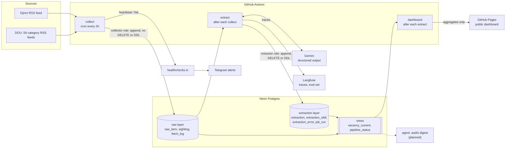

# IT Pulse UA

_AI-аналітика українського IT-ринку вакансій: що наймають, скільки платять і куди рухається ринок._

**Live dashboard: <https://anastasiia-bilska.github.io/it-pulse-ua/>**

## What and why

IT Pulse UA collects public vacancies from DOU and Djinni, turns them into structured facts with an
LLM, and will answer questions about the Ukrainian IT job market with numbers you can trace back to
SQL. RSS feeds keep no history, so collection shipped first and runs every two hours. Trends build
up from the day it started. It is a portfolio project for AI Engineer roles, and it is **in
progress**: collection, extraction and a public dashboard run in production. The eval set is being
labelled, and the agent is planned.

## Status

| Area                                                                                     | Status      |
| ---------------------------------------------------------------------------------------- | ----------- |
| RSS collection: 59 DOU category feeds plus the Djinni feed, every 2h                     | Done        |
| Append-only raw layer, dedup by vacancy id plus content hash, bumps, gaps                | Done        |
| Least-privilege `collector` role, separate `migrate` workflow                            | Done        |
| Guards: CI, post-run data checks, healthchecks.io heartbeat with Telegram alerts         | Done        |
| Extraction schema: tables, CHECK constraints, `extractor` role, freshness views          | Done        |
| LLM extraction with Gemini, evidence-quote checks, retry queue                           | Done        |
| Langfuse traces for every model call (ADR 0010)                                          | Done        |
| Skill taxonomy (ADR 0009): alias dictionary, automated triage, human override            | Done        |
| Public dashboard on GitHub Pages with a freshness banner (ADR 0011)                      | Done        |
| Eval set builder: 150 stratified vacancies to a Langfuse dataset, 30 for blind labelling | Done        |
| Eval harness and PR gate (ADR 0012)                                                      | Done        |
| Uploading and labelling the eval set; first baseline and the gate threshold              | In progress |
| «Запитай ринок» agent, with a mandatory "даних замало" answer when n < 10                | Planned     |
| Weekly audio digest (ElevenLabs)                                                         | Planned     |
| Wave 2: CV match, MCP server                                                             | Planned     |

## Architecture



## Pipeline

1. **Ingest** ([ADR 0002](docs/adr/0002-rss-ingestion-on-github-actions.md)). A cron workflow
   polls all 59 DOU category feeds and the Djinni feed every 2 hours, one request per second, with
   backoff on 429 and 5xx. The User-Agent names this repository. One broken feed never stops the
   others.
2. **Store and dedup** ([ADR 0001](docs/adr/0001-raw-layer-identity-and-dedup.md)). A vacancy is
   identified by `(source, external_id)`, the numeric id, not the RSS guid, which changes on every
   DOU bump. `raw_item` is append-only, one row per content version (sha256 over normalized title,
   description, link and categories). `sighting` records each appearance, so a bump costs one row
   and no extraction. A fetch whose oldest entry is new counts as a coverage **gap** and is logged
   to `fetch_log`.
3. **Check and alert** ([ADR 0005](docs/adr/0005-guards-tests-monitoring-alerts.md)). After each
   run, data checks look for failed feeds, gaps on 3 runs in a row and a volume drop. The run pings
   healthchecks.io: a missing heartbeat or a `/fail` ping reaches Telegram.
4. **Extract** ([ADR 0007](docs/adr/0007-llm-extraction.md)). Gemini
   `gemini-3.5-flash-lite` through the Interactions API returns structured output: role,
   seniority, salary, work format, English, experience, company type, domain and skills. Each field
   is NULL when the vacancy doesn't state it. The queue is every raw version without an extraction
   for the current `extractor_version`, at most 300 per run, with retries and a dead letter after 3
   attempts. Skill names are normalized through the taxonomy
   ([ADR 0009](docs/adr/0009-skill-taxonomy.md)), and every model call is traced in Langfuse
   ([ADR 0010](docs/adr/0010-langfuse-tracing.md)).
5. **Serve** ([ADR 0011](docs/adr/0011-public-dashboard.md)). After each extract run a static
   dashboard is rebuilt from `vacancy_current` and `pipeline_status`: aggregates only, every share
   with its n, and a banner when the data is stale. The agent (planned) reads the same views.

## Engineering practices

- **Guards in layers** ([ADR 0005](docs/adr/0005-guards-tests-monitoring-alerts.md)). The required
  `check` job runs typecheck, ESLint, Prettier, unit tests and integration tests on Postgres 17
  with a fake RSS server. The integration tests run migrations from scratch and connect as the real
  least-privilege role. Data checks run after each collection, and a heartbeat catches a cron that
  never started.
- **Least privilege** ([ADR 0004](docs/adr/0004-least-privilege-collector-role.md)). The
  `collector` role can insert raw data but cannot delete, truncate or rewrite history. The
  `extractor` role can insert extraction results but cannot touch raw data. The owner role is used
  only by the `migrate` workflow.
- **Hallucination guards** ([ADR 0007](docs/adr/0007-llm-extraction.md)). A response schema with
  the same enums as the database, validation in code, and CHECK constraints in Postgres. Salary,
  experience, English and domain need a verbatim evidence quote, and code checks it is a substring
  of the vacancy text. If it isn't, the field is dropped and counted. The model version is pinned,
  temperature is 0, and there is no fallback model.
- **Evals** ([ADR 0012](docs/adr/0012-eval-harness.md)). `npm run eval` scores the current prompt
  and model against the labelled eval set: per-field accuracy, salary and locations as a whole,
  skills precision, recall and F1. Accuracy is reported apart for the 30 blind and the 120
  prelabelled items: the gap measures anchoring bias. Any pull request that touches the extractor
  runs it. The set is still being labelled, so there is no baseline and no threshold yet, and the
  run skips until labels exist.
- **Readability rules** ([CLAUDE.md](CLAUDE.md), [ADR 0006](docs/adr/0006-code-style-and-linting.md)).
  Code reads top-down, with a fixed file layout, intent-revealing names and small functions. ESLint
  enforces the mechanical part. The same rules bind human and AI contributors.
- **Modular layout** ([ADR 0008](docs/adr/0008-modular-layout.md)). One folder per module under
  `src/`. `index.ts` is the only public entry point, and ESLint fails a reach into another module's
  internals.
- **Decisions are recorded.** Every significant decision gets an ADR in the same pull request.

## Data and ethics

- **No raw vacancy text in the repository.** Raw text stays in Postgres. Test fixtures are
  synthetic, and logs and alert bodies carry counts and feed names only, because Actions logs are
  public. Only extracted facts and links will be published.
- **DOU terms.** Clause 2.5 of the DOU terms forbids automated collection without the
  administration's consent. [ADR 0002](docs/adr/0002-rss-ingestion-on-github-actions.md) records
  the decision to ask DOU and Djinni for consent. robots.txt on both sites allows the feeds, and
  the collector is a polite RSS reader: one request per second, every 2 hours.
- **Non-commercial.** DOU content is licensed CC BY-NC-SA. This project is non-commercial
  research. Published results will carry extracted facts and a link back to each vacancy.
- **No Russian-origin services or dependencies.**

## Running locally

Requires Node 24 (TypeScript runs directly, no build step:
[ADR 0003](docs/adr/0003-typescript-without-build-step.md)) and a Postgres database.

```sh
npm ci

# .env (gitignored)
# DATABASE_URL=postgres://<user>:<password>@<host>/<db>
# HEALTHCHECK_URL=  # optional; pinging is skipped when unset

# Migrations grant to the pipeline roles, which live outside migrations (ADR 0004).
# On a fresh local database, create them once first:
psql "$DATABASE_URL" -c 'create role collector; create role extractor;'

npm run migrate   # apply db/migrations/*.sql
npm run collect   # one collection run
```

Tests need a throwaway Postgres. The integration suite **wipes schema `public`** of
`TEST_DATABASE_URL`, so never point it at a real database or at the one you collect into.

```sh
docker run --rm -d --name it-pulse-pg -e POSTGRES_PASSWORD=pg -p 5432:5432 postgres:17
export TEST_DATABASE_URL=postgres://postgres:pg@localhost:5432/postgres

npm run typecheck && npm run lint && npm run format:check
npm test                  # unit tests
npm run test:integration  # Postgres plus a fake RSS server
```

## Repository layout

```text
src/
  collector/     RSS fetch, normalize, dedup, data checks; collect.ts is the CLI
  db/            migration runner, test helpers
  extractor/     Gemini extraction, evidence checks, queue; extract.ts is the CLI
  taxonomy/      skill aliases and triage
  observability/ Langfuse traces and datasets
  evaluation/    eval set sampling, scoring; run-eval.ts is the eval CLI
  dashboard/     public aggregates for GitHub Pages
  shared/        scheduled-job runner: DB connection, healthchecks.io pings
  <module>/tests/  *.test.ts (unit), *.itest.ts (integration)
db/migrations/   plain SQL, applied in order
docs/adr/        architecture decision records
.github/workflows/
  ci.yml         required check on every PR
  collect.yml    cron every 2h, collector role
  migrate.yml    on migration changes, owner role
  extract.yml    after each collect, extractor role
  dashboard.yml  after each extract and daily, publishes to Pages
  eval.yml       eval gate on extractor PRs, or manual
CLAUDE.md        engineering rules for people and AI agents
```

## Architecture decision records

| ADR                                                      | Decision                                                    |
| -------------------------------------------------------- | ----------------------------------------------------------- |
| [0001](docs/adr/0001-raw-layer-identity-and-dedup.md)    | Raw layer: vacancy identity and deduplication               |
| [0002](docs/adr/0002-rss-ingestion-on-github-actions.md) | Ingestion: category RSS feeds polled by GitHub Actions cron |
| [0003](docs/adr/0003-typescript-without-build-step.md)   | TypeScript on Node 24, no build step                        |
| [0004](docs/adr/0004-least-privilege-collector-role.md)  | Least-privilege collector role, GitHub secrets              |
| [0005](docs/adr/0005-guards-tests-monitoring-alerts.md)  | Guards: tests, eval harnesses, data checks, alerts          |
| [0006](docs/adr/0006-code-style-and-linting.md)          | Code style: ESLint, Prettier and written engineering rules  |
| [0007](docs/adr/0007-llm-extraction.md)                  | LLM extraction of structured vacancy fields                 |
| [0008](docs/adr/0008-modular-layout.md)                  | Modular layout with tests in tests/ subfolders              |
| [0009](docs/adr/0009-skill-taxonomy.md)                  | Skill taxonomy: aliases, candidates, append-only decisions  |
| [0010](docs/adr/0010-langfuse-tracing.md)                | LLM traces in Langfuse over OTLP, without an SDK            |
| [0011](docs/adr/0011-public-dashboard.md)                | Public dashboard: static aggregates on GitHub Pages         |
| [0012](docs/adr/0012-eval-harness.md)                    | Extraction eval harness and the PR eval gate                |
